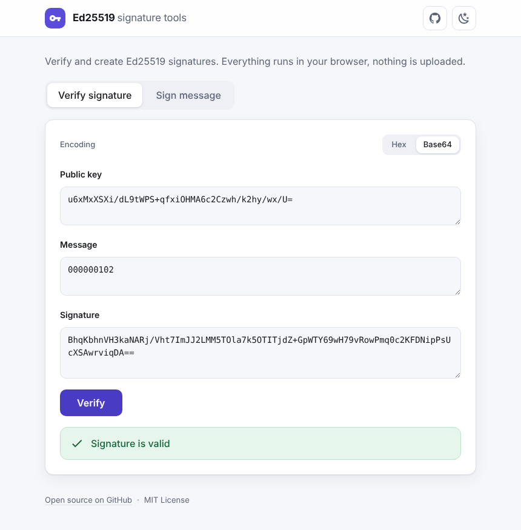
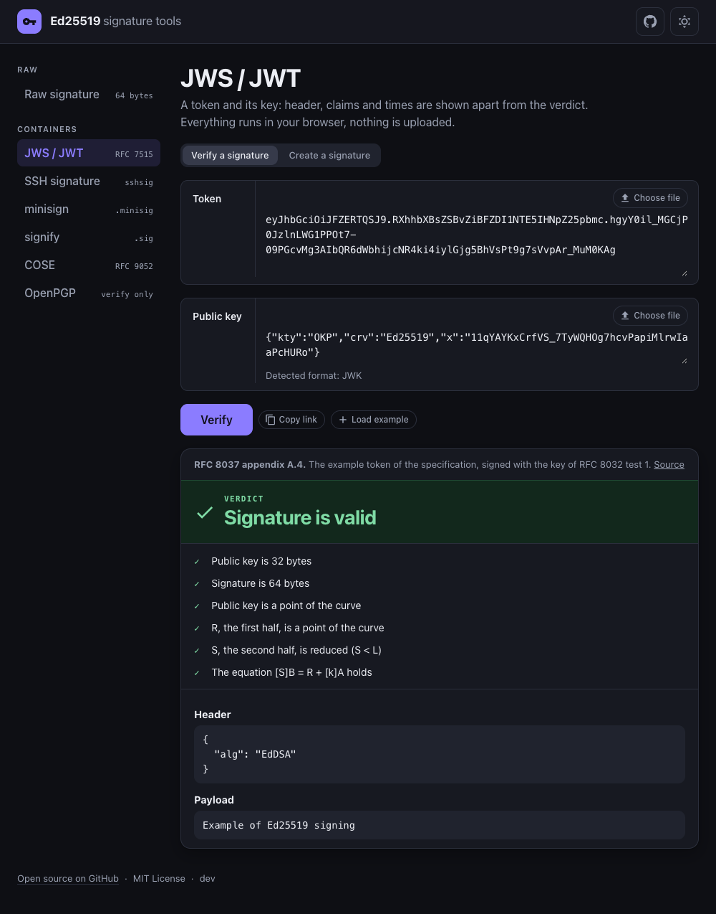

# Ed25519 signature tools

[](https://github.com/altrdev/ed25519-verify/actions/workflows/deploy-to-gh-pages.yml)
[](LICENSE)

Verify and create [Ed25519](https://ed25519.cr.yp.to/) signatures straight from your browser.
Paste a public key, a message and a signature to check them, or sign a message with a private key.
Everything runs client-side: **nothing is uploaded anywhere**.

**Live demo: <https://ed25519.altr.dev/>**

<p align="center">
  
  
</p>

## Features

- **Verify** a signature given a public key and a message, with a clear valid / wrong result.
- **Sign** a message with a private key; the public key is deduced and shown next to it.
- **Generate** a random key pair with one click, handy for trying things out.
- **Clear input errors**: a malformed key or signature is explained next to the field ("expected 32 bytes, got 31",
  "not in a recognised format") instead of being reported as a wrong signature.
- Messages as **text, hex or base64**, so binary payloads can be signed and verified as well.
- Keys in **PEM, OpenSSH or JWK** pasted as they are (detected automatically), or as plain hex / base64.
- **Share a verification**: *Copy link* on the Verify tab makes a link with the public key, message and signature in the part after `#`, which browsers never send to any server. Whoever opens it sees the fields filled in and the result at once. Private keys are never put in a link.
- **Formats are recognised by themselves** for keys and signatures: hex, `0x` hex, base64, base64url, base58, base32 or a list of bytes, mixed as you like. When a text could be two things (rare) you are asked to pick, never guessed for. A menu on every field converts it to another format.
- Private key hidden by default, one-click **copy** for private and public keys and for signatures.
- Light and dark theme, responsive layout, installable as a **PWA** (assets are precached by a service worker).

## Input formats

| Field | Format |
| --- | --- |
| Message | Plain text (signed as UTF-8 bytes), or raw bytes written in hex or base64. Empty messages are allowed |
| Public key | 32 bytes written as hex, `0x` hex, base64 (also URL-safe), base58, base32 or a list of numbers, or a key pasted as it is in a standard format: PEM (`BEGIN PUBLIC KEY`), OpenSSH (`ssh-ed25519 AAAA…`), JWK, `did:key`, a Stellar `G…` address, a Tor v3 `.onion` address or a NEAR `ed25519:…` key |
| Private key | The 32-byte seed in any of the above notations (the 64-byte form, seed followed by public key, is accepted too, e.g. a Solana keypair file: the seed is used), or PEM PKCS#8 (`BEGIN PRIVATE KEY`), an unencrypted OpenSSH private key (`BEGIN OPENSSH PRIVATE KEY`) or a JWK, a Stellar `S…` seed or a NEAR `ed25519:…` secret key |
| Signature | 64 bytes in any of the notations above |

The notations: hex (`00ff10`), `0x`-prefixed hex, base64 and base64url (padding optional, wrapped lines fine), base58 (the
Bitcoin alphabet, as Solana, NEAR or IPFS write keys and signatures), base32 (RFC 4648) and a list of numbers such as
`[12, 34, 56]` (a Solana keypair file, or what Rust, Go and JavaScript print).

**Keys in other formats are recognised by themselves** as well: paste the content of the file and a
"Detected format" note appears under the field. A public key field also accepts a private JWK or OpenSSH private key (it
contains the public part). Keys of another type (RSA, EC, X25519, Ed448...) and keys protected by a passphrase are refused with
a message that says so; to use an encrypted key, remove the passphrase first (`ssh-keygen -p -f key`, or
`openssl pkey -in key.pem -out plain.pem`).

Signatures are checked with the strict rules of RFC 8032 / FIPS 186-5 (not the more permissive ZIP215 rules), so
"valid" means that a standards-compliant verifier agrees. In the rare case of a signature that fails the strict check
but would be accepted under ZIP215 (used by some consensus systems, e.g. Zcash), the result says so instead of just "wrong".

**No format to select for keys and signatures**: the app works it out. A key or a signature has only a few possible sizes
(a 32-byte key is 64 hex characters, 43 or 44 in base64, 43 or 44 in base58; a 64-byte signature is 128, 86 or 88, 87 or 88),
and in nearly every case only one reading of the text has such a size. A text made of hex digits only is always hex, so a
truncated hex key gets "expected 32 bytes, got 21" instead of being mistaken for something else.

**When a text could be two things**, the app does not guess. About 1 in 16 base58 keys has 43 characters, and 43 characters
are also a valid unpadded base64 key (a different one). It then says so and offers *Read as base64* and *Read as base58*:
one click settles it. The choice is dropped as soon as you edit the text.

**Every key and signature field has a format menu** (the small button next to *Copy*). It shows what the text was
recognised as, and picking another format **rewrites the field in that format**: the same bytes, written another way, so the
app doubles as a converter (a PEM public key to hex, a base58 signature to base64, a keypair file to a seed...). In the
fields that are results (the signature, a generated or deduced key) the menu chooses how they are written. The choice is
remembered for each field. Key fields also have a **Key files** group: PEM (PKCS#8 / SPKI), OpenSSH and JWK, so a hex seed can be exported as a `.pem`, an `id_ed25519` file or a JWK (and *Generate* writes a new pair that way). An **Ecosystems** group adds `did:key`, Stellar (`G…` / `S…`), Tor v3 `.onion` addresses, NEAR (`ed25519:…`) and the Solana keypair file; they are recognised when pasted too, and their checksums (Stellar CRC16, onion SHA3) are verified, so a mistyped character is reported instead of giving another key. The message has its own Text / Hex / Base64 selector (a text cannot tell "abcd" the string
from "abcd" the two bytes), so you can sign and verify binary data (hashes, already encoded payloads) too.

## Privacy

Signing and verification use [@noble/ed25519](https://github.com/paulmillr/noble-ed25519) in your browser and the app makes no
requests with your data. The page ships a strict [Content-Security-Policy](src/csp.ts) (same-origin requests only, no inline scripts),
so the browser itself refuses any request the page tries to make to another site. Even so, treat any web page with care: do not paste production private keys into tools you have not audited,
and prefer throwaway keys for testing. The source is small enough to read.

## Development

Requires Node.js 22 or newer.

```bash
npm install
npm run dev        # dev server with hot reload
npm test           # unit and component tests (Vitest + Testing Library)
npm run build      # type-check and production build in dist/
npm run preview    # serve the production build locally
```

Stack: [Preact](https://preactjs.com) with [@preact/signals](https://preactjs.com/guide/v10/signals/),
[Vite](https://vitejs.dev), [Vitest](https://vitest.dev) and [vite-plugin-pwa](https://vite-pwa-org.netlify.app/).

```
src/
  signature.ts      Ed25519 wrapper (hex/base64 conversion, sign, verify, public key)
  store.ts          theme and encoding preferences (signals, persisted in localStorage)
  App.tsx           page shell, tabs, theme toggle
  FormVerify.tsx    verify tab
  FormSign.tsx      sign tab
  __tests__/        tests
```

### Deployment

Every push to `main` is tested, built and published to GitHub Pages by
[`.github/workflows/deploy-to-gh-pages.yml`](.github/workflows/deploy-to-gh-pages.yml).
In the repository settings, **Pages → Source** must be set to **GitHub Actions**.

## Contributing

Issues and pull requests are welcome, see [CONTRIBUTING.md](CONTRIBUTING.md). Tagged versions are listed under
[Releases](https://github.com/altrdev/ed25519-verify/releases).

## License

[MIT](LICENSE) © Alessandro Travi
